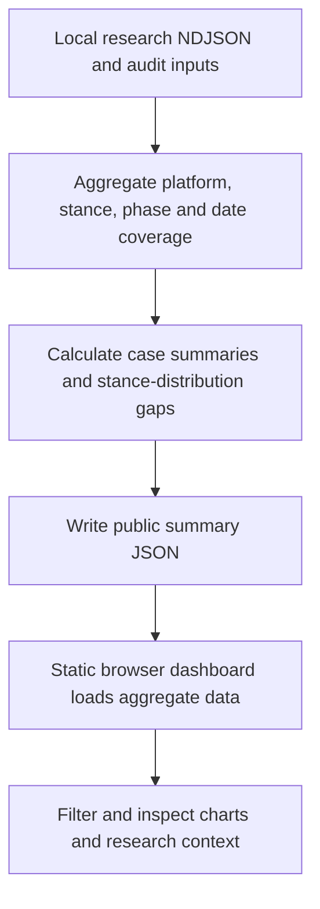

# Women’s Safety Discourse Dashboard: workflow

Publish aggregate views of an existing research corpus so readers can inspect coverage, stance distributions and case-level differences without exposing raw posts.

**Relevant roles:** data science, data analysis.

## Flowchart

## Explain it in an interview

“I turn research outputs into a public aggregate dashboard while preserving the distinction between corpus coverage, label provenance and interpretation. I can explain what a chart supports and what it cannot conclude.”

## What this diagram does and does not establish

The upstream raw corpus is not shipped here. This repository visualizes exported research artifacts; it does not establish that every label was human-reviewed or reproduce the upstream model-training process. Stance-distribution differences describe discourse and do not establish causal or population-wide effects.

## Follow the code

- [Aggregate export builder](scripts/build_public_summary.py)
- [Published aggregate artifact](docs/data/public_summary.json)
- [Dashboard data loading and interactions](docs/app.js)
- [Evidence and interpretation boundaries](EVIDENCE.md)
